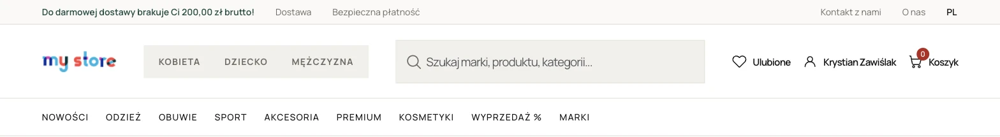
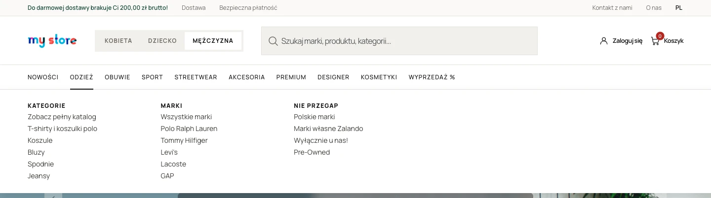
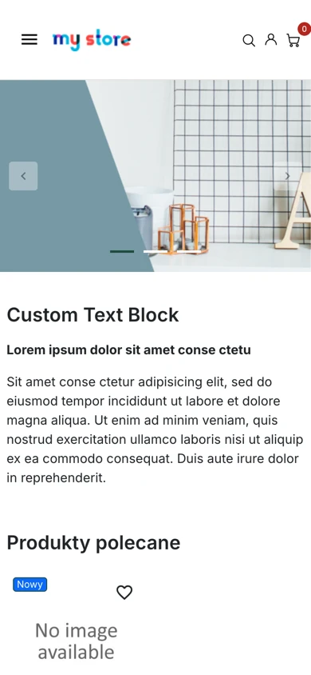
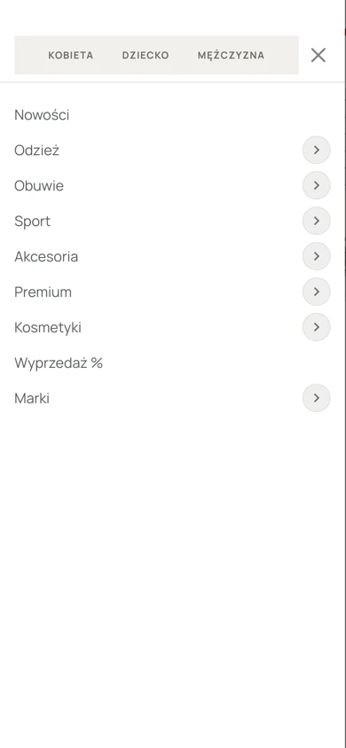
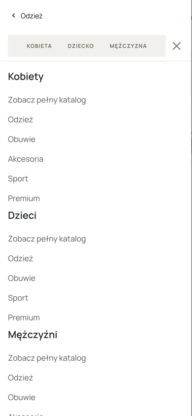

# Header Presta 1

A custom PrestaShop 9 header built on the Hummingbird theme. It has a Women/Kids/Men switcher, a configurable mega menu and a drill-down mobile menu. This is a design MVP: only the header is customized and the rest of the store is stock Hummingbird.



## Features

- **Mega menu module** (`megamenu`): each top item has up to 5 fixed column slots, managed in the back office. Columns contain category, brand or custom links.
- **Audience switcher** (Women / Kids / Men): swaps the whole menu set, and each audience has its own menu.
- **Mobile drill-down** inside the hamburger menu (<992px)
- **Free shipping bar** module and a wishlist icon in the header



<p>
  
  
  
</p>

## Getting started

Requirements: Docker with Compose v2, and free ports `1000` and `3307`.

```bash
git clone https://github.com/KrystianZawislak/header-presta-1.git
cd header-presta-1

cat > .env <<EOF
DB_ROOT_PASSWD=$(openssl rand -hex 24)
DB_PASSWD=$(openssl rand -hex 24)
ADMIN_MAIL=
ADMIN_PASSWD=
EOF
# fill in ADMIN_MAIL / ADMIN_PASSWD (8+ chars, no spaces or $)

docker compose up -d
docker compose logs -f prestashop   # wait for "Starting web server now" (~3–5 min)
```

- Store: http://localhost:1000
- Back office URL: `docker compose logs prestashop | grep backoffice`. Log in with the credentials from `.env`.

Keep the DB passwords alphanumeric, because the PrestaShop image installer doesn't handle special characters.

If the install stops at `Cannot download language pack`, reset and try again:

```bash
docker compose down && rm -rf db_data && git clean -fdX prestashop && docker compose up -d
```

## How it works

PrestaShop and MariaDB images are pinned by digest. On first start, `docker/post-install/import-project.sh` imports `docker/db/prestashop.sql` (modules, menus, categories, config) and restores `docker/files/` (images, translations, mail templates). The dump contains no customer data or secrets.

After back-office changes, run `./docker/export.sh` to refresh the dump and file snapshot.

## Repository layout

Only customizations are tracked, and the rest of `prestashop/` is ignored:

- `prestashop/modules/`: `megamenu`, `freeshippingbar`, `designassets`
- `prestashop/themes/hummingbird/`: header template, CSS, fonts and module template overrides
- `prestashop/override/`: wishlist header hook
- `docker/`: DB dump, file snapshot and install scripts

## Production notes

- Enable the CSS, JS and Smarty caches (*Advanced Parameters → Performance*). They are disabled in the dump for development.
- Ports are bound to `127.0.0.1`. Put the store behind an HTTPS reverse proxy and set `PS_DOMAIN` in `docker-compose.yml` before the first install.
